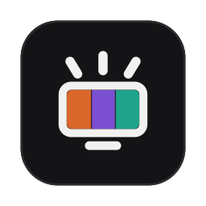

<p align="center">
  
</p>

<h1 align="center">LscSync</h1>

<p align="center">
  Your LSC Smart Connect lights take on the colors of your screen and pulse to your music.
</p>

<p align="center">
  <a href="https://github.com/jonag972/LscSync/releases/latest"><b>Download</b></a>
  · macOS · Windows · Linux
</p>

---

LscSync runs from the menu bar (macOS, Linux) or the system tray (Windows) and drives your
**LSC Smart Connect** lights directly over Wi-Fi.

- **Screen**: each light follows the part of the screen you give it, placed on a live preview.
  A light with several zones, like the LSC panel kit, gets one color per zone, applied
  instantly.
- **Ambience**: every light takes the dominant color at the top of the screen.
- **Music**: the lights pulse on the bass, in rainbow or in one color.
- **Color**: every light shows a color you pick.

Choose which lights take part in each mode and press Start. Changes to the settings apply
immediately.

## Install

Download the [latest release](https://github.com/jonag972/LscSync/releases/latest) for your
system:

- **macOS** (`.dmg`, for both Apple Silicon and Intel Macs): open it and drag *LscSync*
  into Applications. On first launch, allow the app in System Settings › Privacy & Security ›
  **Screen Recording** (*Screen & System Audio Recording* on recent macOS). This permission
  lets it see the screen and hear the sound.
- **Windows** (`-setup.exe`): run the installer. The app isn't signed yet, so Windows may show
  a SmartScreen warning. Click *More info*, then *Run anyway*. A portable `.zip` is also
  available.
- **Linux**: on Ubuntu, Debian or Mint, open the `.deb` to install it from the software center.
  On other distributions, take the `.AppImage`, make it executable (`chmod +x`) and run it.

| | macOS 13 or later | macOS 12.3 – 12.7 | Windows 10 and 11 | Linux (x86_64)\* |
|---|---|---|---|---|
| Screen, Ambience, Color | ✓ | ✓ | ✓ | ✓ |
| Music | ✓ computer sound | ✓ through the microphone | ✓ computer sound | ✓ computer sound |

macOS 12 doesn't let apps hear the computer's sound, so Music mode listens through the Mac's
microphone instead. Turn the speakers up for the best bass.

\* Linux: Ubuntu 24.04, Debian 13, Fedora 40 or newer (or any distribution with PipeWire 1.0),
with a Vulkan graphics driver, Wayland or X11, and PulseAudio or PipeWire. On GNOME, the menu
bar icon needs the *AppIndicator* extension.

The Windows and Linux versions are new. If something doesn't work, please
[open an issue](https://github.com/jonag972/LscSync/issues).

The app is in English and French and follows your system's language. You can change it in
**Settings**.

## Connect your lights

The first time you open the app, it walks you through it:

1. In the LSC Smart Connect app on your phone, go to Me › Settings › Account and Security and
   copy your **User Code** into LscSync.
2. Scan the QR code that appears with the LSC app's scanner, and confirm.
3. Your devices show up, and the ones found on your Wi-Fi network are ready to use. Pick the
   one that follows your screen.

To set up another computer without scanning again, use **Manage my lights › Export profile**, then
**Import** on the other computer. The exported file holds your devices' keys, so keep it to
yourself.

## Your data

Colors go straight from your computer to your lights over your own Wi-Fi network, and
nowhere else.

- No account, no analytics, no tracking.
- The screen and sound are analyzed in memory to compute a few colors, then discarded. Nothing
  is recorded or stored.
- During setup, the app contacts Tuya's servers (the platform behind LSC Smart Connect) to
  fetch your devices' keys. After that, your lights are driven locally.
- To tell you about new versions, it asks GitHub for the latest release at launch and once a
  day. The request carries nothing about you or your devices, and you can turn it off in
  **Settings**.

## Which lights work?

Any LSC Smart Connect color light works with a single zone. Several zones per light have only
been tested with the LSC Smart Connect light panel kit sold at Action.

> Independent project, **not affiliated** with Action, LSC Smart Connect or Tuya. All trademarks
> belong to their respective owners.

---

## For developers

Written in Rust, with [GPUI](https://www.gpui.rs) for the interface.

```sh
cargo run -p lscsync-app             # the app
cargo test --workspace               # tests
cargo run -p lscsync-cli -- help     # diagnostics: status, test pattern, back to white, audio
./tools/bundle-macos.sh --dmg        # universal "LscSync.app" and .dmg (macOS)
./tools/appimage.sh                  # AppImage (Linux; ./tools/linux-deps.sh installs the libraries)
./tools/deb.sh                       # .deb package (Linux; installs cargo-deb if needed)
./tools/generate-icons.sh            # icons and installer art from assets/icon and assets/installer
```

The Windows installer is described in `installer/windows.iss` (Inno Setup). The release
workflow builds every download when a `v*` tag is pushed and opens a draft GitHub release.

| Crate | Role |
|---|---|
| `crates/core` | Pure logic: colors, Tuya protocol, profile, settings and preferences |
| `crates/engine` | Local Tuya connection, screen and audio capture, sync thread |
| `crates/cloud` | Tuya QR code login |
| `crates/platform` | Per-OS folders |
| `crates/app` | Interface, menu bar, update check; its texts are in `crates/app/locales` |
| `crates/cli` | Command-line diagnostics |

### How it works

- **Screen**: 25 captures per second, 1 pixel in 8. In each zone, vivid pixels weigh up to ~4×
  more than grays and blacks, so text and black bars don't wash out the color.
- **Sound**: bass detection by FFT (peak of the 20–250 Hz band), with a fast attack and an 8×
  slower release. Captured with ScreenCaptureKit on macOS 13+ (microphone on macOS 12), WASAPI
  loopback on Windows, and the output monitor through PulseAudio / PipeWire on Linux. No
  driver needed.
- **Lights**: Tuya local protocol v3.5. Multi-zone lights get a 12-segment scene (DP 51), one
  color per zone, applied instantly. Single colors go through DP 27 (instant) when the light
  has it, and DP 24 (which fades) otherwise. The formats were found by trial and error, see
  [docs/lsc-protocol.md](docs/lsc-protocol.md).

## License

Made by [Jonathan Gromat](https://jonathan-gromat.vercel.app/en). Released under the
[MIT license](LICENSE); the bundled Geist fonts are under the
[SIL Open Font License](crates/app/assets/fonts/OFL.txt).
