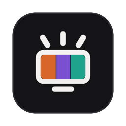

<p align="center">
  
</p>

<h1 align="center">LscSync</h1>

<p align="center">
  Your LSC light panels take on the colors of your screen and pulse to your music.
</p>

<p align="center">
  <a href="https://github.com/jonag972/LscSync/releases/latest"><b>Download</b></a>
  · macOS · Windows · Linux
</p>

---

A movie, a game, a playlist: the light behind your screen follows what's on it.
LscSync sits quietly in your menu bar and drives your **LSC Smart Connect** panels
directly over Wi-Fi.

- **Ambilight**: the panels pick up the colors along the top of your screen, left, middle
  and right.
- **Color**: the whole room takes on the dominant color at the top of the screen.
- **Music**: the panels light up on the bass, with a cycling or fixed color.

One click to start. Brightness, saturation and smoothness apply live, while it runs.

## Install

Download the [latest release](https://github.com/jonag972/LscSync/releases/latest) for your
system:

- **macOS** (`.dmg`, for both Apple Silicon and Intel Macs): open it and drag *LscSync*
  into Applications. On first launch, allow the app in System Settings › Privacy & Security ›
  **Screen Recording** (*Screen & System Audio Recording* on recent macOS): that's what lets it
  see the screen and hear the sound.
- **Windows** (`-setup.exe`): run the installer. The app isn't signed yet, so Windows may show
  a SmartScreen warning: click *More info*, then *Run anyway*. A portable `.zip` is also
  available.
- **Linux**: on Ubuntu, Debian or Mint, open the `.deb` to install it from the software center.
  On other distributions, take the `.AppImage`: make it executable (`chmod +x`) and run it.

| | macOS 13 or later | macOS 12.3 – 12.7 | Windows 10 and 11 | Linux (x86_64)\* |
|---|---|---|---|---|
| Ambilight, Color | ✓ | ✓ | ✓ | ✓ |
| Music | ✓ computer sound | ✓ through the microphone | ✓ computer sound | ✓ computer sound |

On macOS 12, the system doesn't let apps hear the computer's sound, so Music mode listens
through the Mac's microphone: turn the speakers up for the best bass.

\* Linux: Ubuntu 24.04, Debian 13, Fedora 40 or newer (or any distribution with PipeWire 1.0),
with a Vulkan graphics driver, Wayland or X11, and PulseAudio or PipeWire. On GNOME, the menu
bar icon needs the *AppIndicator* extension.

The Windows and Linux versions are new: if something doesn't work, please
[open an issue](https://github.com/jonag972/LscSync/issues). The app is in French for now.

## Connect your panels

The first time you open the app, it walks you through it:

1. In the LSC Smart Connect app on your phone, go to Me › Settings › Account and Security and
   copy your **User Code** into LscSync.
2. Scan the QR code that appears with the LSC app's scanner, and confirm.
3. Your devices show up, with the ones found on your Wi-Fi network ready to use. Pick the one
   that follows your screen, and you're done.

To set up another computer without scanning again, use **Appareils › Exporter le profil**, then
**Importer** on the other computer. The exported file holds your devices' keys: keep it to
yourself.

## Your data

Colors go straight from your computer to your LSC devices, on your own Wi-Fi network, and
nowhere else.

- No account, no analytics, no tracking.
- The screen and sound are analyzed in memory to compute a few colors, then discarded. Nothing
  is recorded or stored.
- The only time the app goes online is during setup: it contacts Tuya's servers (the platform
  behind LSC Smart Connect) to fetch your devices' keys. After that, everything stays local.

## Is my kit compatible?

LscSync is designed and tested with the LSC Smart Connect light panel kit sold at Action.

> Independent project, **not affiliated** with Action, LSC Smart Connect or Tuya. All trademarks
> belong to their respective owners.

---

## For developers

Written in Rust, with [GPUI](https://www.gpui.rs) for the interface.

```sh
cargo run -p lscsync-app             # the app
cargo test --workspace               # tests
cargo run -p lscsync-cli -- help     # diagnostics: status, test pattern, back to white, audio
./tools/bundle-macos.sh --dmg        # universal "LscSync.app" and .dmg (macOS)
./tools/appimage.sh                  # AppImage (Linux; ./tools/linux-deps.sh installs the libraries)
./tools/deb.sh                       # .deb package (Linux; installs cargo-deb if needed)
./tools/generate-icons.sh            # icons and installer art from assets/icon and assets/installer
```

The Windows installer is described in `installer/windows.iss` (Inno Setup). The release
workflow builds every download when a `v*` tag is pushed and opens a draft GitHub release.

| Crate | Role |
|---|---|
| `crates/core` | Pure logic: colors, panel protocol, profile and settings |
| `crates/engine` | Local Tuya connection, screen and audio capture, sync thread |
| `crates/cloud` | Tuya QR code login, the only code that goes online |
| `crates/platform` | Per-OS folders |
| `crates/app` | Interface and menu bar |
| `crates/cli` | Command-line diagnostics |

### How it works

- **Screen**: 25 captures per second, 1 pixel in 8. In each zone, vivid pixels weigh up to ~4×
  more than grays and blacks, so text and black bars don't wash out the color.
- **Sound**: bass detection by FFT (peak of the 20–250 Hz band), fast attack and an 8× slower
  release. Captured with ScreenCaptureKit on macOS 13+ (microphone on macOS 12), WASAPI
  loopback on Windows, and the output monitor through PulseAudio / PipeWire on Linux; no
  driver needed.
- **Panels**: Tuya local protocol v3.5. Ambilight and Music use a scene (DP 51), applied
  instantly, rather than the single color (DP 24), which fades. Formats found by trial and
  error: [docs/lsc-protocol.md](docs/lsc-protocol.md).

## License

Made by [Jonathan Gromat](https://jonathan-gromat.vercel.app/en). Released under the
[MIT license](LICENSE); the bundled Geist fonts are under the
[SIL Open Font License](crates/app/assets/fonts/OFL.txt).
